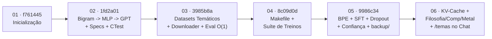

# Changelogs — Evolução do `cpp-vibes-ai`

Esta pasta registra a história técnica completa do repositório, commit a commit, explicando **o que mudou**, **por que mudou** e **como o modelo evoluiu** em arquitetura, dados, engenharia e qualidade de conversa.

## Índice de Changelogs

| # | Commit | Data | Resumo da Evolução | Arquivo |
| :---: | :---: | :---: | :--- | :--- |
| **01** | `f761445` | 2026-11-26 | Criação do repositório, `.gitignore` e licença GPLv3 | [01_f761445_inicializacao.md](01_f761445_inicializacao.md) |
| **02** | `1fd2a01` | 2026-11-26 | Trilha educativa completa (Bigram → MLP → Mini-Transformer), `src/comum/`, `.spec/`, `AGENTS.md`, `docs/` e testes `CTest` | [02_1fd2a01_trilha_educativa_e_testes.md](02_1fd2a01_trilha_educativa_e_testes.md) |
| **03** | `3985b8a` | 2026-11-26 | 3 novos datasets temáticos UTF-8, downloader de grandes corpora (`OASST1`, `Alpaca-PT`) e otimização da avaliação | [03_3985b8a_datasets_e_avaliacao_escalavel.md](03_3985b8a_datasets_e_avaliacao_escalavel.md) |
| **04** | `8c09d0d` | 2026-11-26 | `Makefile` com atalhos de build/testes/chat, suíte de treinos e benchmark comparativo | [04_8c09d0d_makefile_e_suite_de_treinos.md](04_8c09d0d_makefile_e_suite_de_treinos.md) |
| **05** | `9986c34` | 2026-11-26 | Byte-Level BPE, SFT (máscara de loss), Weight Tying, Dropout, retomada de AdamW (`VBGPT02`), confiança/fallback no chat e arquivamento em `backup/` | [05_9986c34_bpe_sft_dropout_e_confianca.md](05_9986c34_bpe_sft_dropout_e_confianca.md) |
| **06** | *atual* | 2026-11-26 | KV-Cache na geração, datasets de Filosofia, Computação e Rock/Metal, escalamento `D=128 / BPE=640`, `/temas` no chat e diretrizes de changelog no `AGENTS.md` | [06_kv_cache_datasets_e_temas.md](06_kv_cache_datasets_e_temas.md) |
