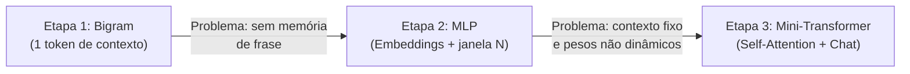

# Roteiro Educativo — Construindo uma IA Conversacional do Zero em C++

Este projeto segue uma **trilha progressiva**: em vez de pular direto para um Transformer complexo, construímos modelos cada vez mais capazes. Cada nova etapa existe para resolver uma **limitação concreta** da etapa anterior.

## Etapa 1 — Modelo Bigram (Estatístico e Neural)
- **Objetivo**: Entender a tarefa fundamental de todo LLM — **prever o próximo token**.
- **O que você aprende**:
  - Tokenização UTF-8 (transformar texto em números).
  - Probabilidade condicional $P(x_{t+1} \mid x_t)$.
  - Como transformar números livres (*logits*) em probabilidades com `softmax`.
  - Função de perda (*Cross-Entropy* / *Negative Log-Likelihood*).
  - **Gradiente Descendente** calculado na mão e paralelizado com **OpenMP**.
  - Geração autoregressiva e o papel da **temperatura**.
- **Limitação observada**: Como o modelo só olha **1 caractere anterior**, ele gera sílabas parecidas com português, mas não forma frases coerentes nem entende a pergunta do usuário.

## Etapa 2 — MLP (Multi-Layer Perceptron, estilo Bengio 2003)
- **Objetivo**: Dar **memória de curto prazo** e **representação semântica** ao modelo.
- **O que vamos adicionar**:
  - **Tabela de Embeddings**: cada token vira um vetor denso de números aprendíveis.
  - **Janela de contexto**: olhar os últimos $N$ tokens (ex.: 16 ou 32 caracteres) ao mesmo tempo.
  - **Camadas ocultas não-lineares** (`tanh` / `ReLU`) + *Backpropagation* completo (regra da cadeia).
  - Treinamento com **Mini-Batches** e separação treino/validação para observar *overfitting*.
- **Limitação observada**: A janela é rígida e cada posição tem pesos independentes, o que dificulta capturar relações longas entre o que o usuário perguntou e o que a IA está respondendo.

## Etapa 3 — Mini-Transformer Conversacional (Estilo GPT)
- **Objetivo**: Implementar a arquitetura moderna por trás de assistentes conversacionais.
- **O que vamos adicionar**:
  - **Embeddings Posicionais** + **Causal Self-Attention** ($Q, K, V$ com máscara triangular).
  - **Multi-Head Attention**, **LayerNorm**, **Feed-Forward Network** e **Conexões Residuais**.
  - Otimizador **AdamW** e agendamento de taxa de aprendizado.
  - **Serialização de pesos** (salvar/carregar modelo treinado em disco).
  - **Chat conversacional** usando histórico formatado (`Usuario: ... / IA: ...`) e amostragem `top-k` / temperatura.
