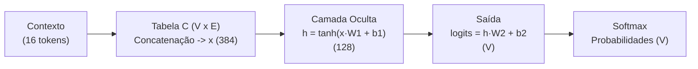

# Etapa 2 — MLP de Linguagem (Embeddings, Contexto e Backpropagation)

Na Etapa 1 (Bigram), o modelo olhava apenas **1 caractere anterior**. Nesta etapa, damos um grande salto inspirado no artigo clássico de Yoshua Bengio et al. (2003), *"A Neural Probabilistic Language Model"*:

1. **Embeddings** para representar cada token como um vetor denso aprendível.
2. **Janela de contexto** de $B = 16$ caracteres anteriores.
3. **Camada oculta não-linear (`tanh`)** capaz de combinar padrões complexos.
4. **Backpropagation manual** verificado com *Gradient Checking* numérico.

---

## 1. Arquitetura e Dimensões (*Shapes*)

Seja:
- $V$: tamanho do vocabulário (número de caracteres únicos).
- $B = 16$: tamanho da janela de contexto.
- $E = 24$: dimensão do vetor de embedding de cada token.
- $D = B \cdot E = 384$: tamanho do vetor de entrada concatenado.
- $H = 128$: número de neurônios na camada oculta.



### Por que Embeddings?

Se representássemos cada caractere como um vetor *one-hot* gigante, `'a'` e `'e'` seriam completamente ortogonais. Com a tabela de embeddings $C \in \mathbb{R}^{V \times E}$, a própria rede aprende coordenadas contínuas onde caracteres com papéis semelhantes (vogais, consoantes, pontuações) ficam próximos no espaço vetorial!

---

## 2. Passo a Passo do *Forward Pass*

Dado um contexto $(t_0, t_1, \dots, t_{B-1})$ e o token alvo $y$:

1. **Busca e concatenação na tabela $C$**:
   $$x = [\,C[t_0],\; C[t_1],\; \dots,\; C[t_{B-1}]\,] \in \mathbb{R}^{B \cdot E}$$
2. **Camada oculta com `tanh`**:
   $$z_1 = x W_1 + b_1, \qquad h = \tanh(z_1) \in \mathbb{R}^{H}$$
3. **Logits e probabilidades**:
   $$\text{logits} = h W_2 + b_2 \in \mathbb{R}^{V}, \qquad p = \text{softmax}(\text{logits})$$
4. **Perda (Entropia Cruzada)**:
   $$\mathcal{L} = -\ln(p_y)$$

---

## 3. Backpropagation Manual (Regra da Cadeia)

Aplicando a regra da cadeia de trás para frente em [mlp.hpp](../src/etapa2_mlp/mlp.hpp):

1. **Saída (Softmax + Cross-Entropy)**:
   $$\frac{\partial \mathcal{L}}{\partial \text{logits}_v} = p_v - \mathbb{I}[v = y]$$
2. **Pesos da camada de saída ($W_2, b_2$) e propagação para $h$**:
   $$dW_2 = h^\top \, d\text{logits}, \qquad db_2 = d\text{logits}, \qquad dh = d\text{logits} \, W_2^\top$$
3. **Através da ativação $\tanh$**:
   Como $\frac{d}{dz}\tanh(z) = 1 - \tanh^2(z) = 1 - h^2$:
   $$dz_1 = dh \odot (1 - h^2)$$
4. **Pesos da camada oculta ($W_1, b_1$) e propagação para $x$**:
   $$dW_1 = x^\top \, dz_1, \qquad db_1 = dz_1, \qquad dx = dz_1 \, W_1^\top$$
5. **De volta à tabela de Embeddings $C$ (*scatter-add*)**:
   Para cada posição $p \in [0, B)$, **somamos** (`+=`) a fatia correspondente de $dx$ na linha $dC[t_p]$. Somar (e nunca sobrescrever) é crucial porque o mesmo caractere pode aparecer várias vezes na janela de contexto.

---

## 4. Verificação de Gradiente (*Gradient Checking*)

Em Machine Learning, um erro de sinal ou índice no backpropagation muitas vezes **compila e roda sem travar**, mas faz a rede aprender errado. Para provar que nossas derivadas analíticas estão corretas, usamos diferenças finitas centradas:

$$\frac{\partial \mathcal{L}}{\partial \theta} \approx \frac{\mathcal{L}(\theta + \varepsilon) - \mathcal{L}(\theta - \varepsilon)}{2\varepsilon}$$

Você pode rodar essa verificação tanto na suíte `ctest` quanto diretamente pela CLI:

```bash
./build/etapa2_mlp dados/dialogos.txt --verificar-gradiente
```

---

## 5. Treino, Validação, Momentum e Checkpoints

- **Divisão Treino (90%) / Validação (10%)**: permite enxergar na prática a diferença entre memorizar o conjunto de treino (*overfitting*) e generalizar para diálogos não vistos.
- **Mini-Batch SGD + Momentum ($\beta = 0{,}9$)**: acumula "inércia" na direção média dos gradientes, acelerando a convergência e suavizando oscilações.
- **Salvar e Carregar Pesos**: você pode treinar uma vez e conversar depois instantaneamente:

```bash
# Treinar e salvar pesos
./build/etapa2_mlp dados/dialogos.txt --salvar modelo_mlp.vibes

# Carregar pesos já treinados direto para o chat
./build/etapa2_mlp dados/dialogos.txt --carregar modelo_mlp.vibes
```

---

## 6. O que ainda falta? (Gancho para a Etapa 3)

Mesmo sendo muito superior ao Bigram, a MLP tem duas limitações estruturais:
1. A **janela é fixa e curta** (16 caracteres não bastam para lembrar uma pergunta inteira enquanto gera a resposta).
2. Os pesos em $W_1$ dependem rigidamente da posição absoluta na janela — se uma palavra deslocar 2 caracteres para a esquerda, ela aciona outros pesos.

Na **Etapa 3 (Mini-Transformer)**, resolveremos isso com o mecanismo de **Self-Attention**, onde qualquer token pode consultar diretamente qualquer token anterior da conversa!
