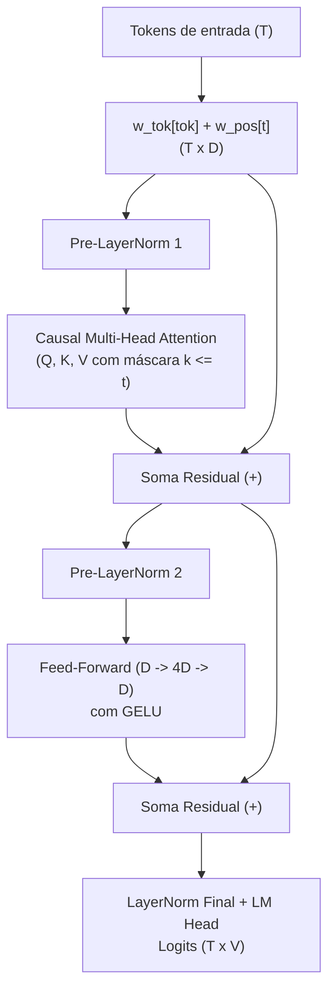

# Etapa 3 — Mini-Transformer Conversacional (Estilo GPT)

Nesta etapa final da trilha base, implementamos do zero em C++20 a mesma arquitetura fundamental por trás dos grandes modelos de linguagem modernos (**GPT / Decoder-Only Transformer**):

- **Embeddings de Token + Posição** (até $T_{\max} = 64$ tokens de contexto).
- **Pre-LayerNorm** + **Causal Multi-Head Self-Attention** ($Q, K, V, O$).
- **Feed-Forward Network** com ativação **GELU** e **Conexões Residuais**.
- **Backpropagation completo** verificado numericamente em todos os tensores.
- **Otimizador AdamW** com *Gradient Clipping* e *Cosine Learning Rate Schedule*.
- **Chat com histórico**, amostragem **Temperatura + Top-K** e **checkpoints `.vibes`**.

---

## 1. Fluxo do Mini-Transformer



---

## 2. Por que Causal Self-Attention resolve os limites da MLP?

Na Etapa 2 (MLP), cada posição da janela tinha pesos fixos em $W_1$. No Transformer, **cada token decide dinamicamente a quais tokens anteriores prestar atenção**:

1. Cada posição $t$ projeta seu estado em três vetores:
   - **Query ($Q_t$)**: *"o que estou procurando?"*
   - **Key ($K_k$)**: *"o que eu ofereço de informação?"*
   - **Value ($V_k$)**: *"qual conteúdo vou passar se for escolhido?"*
2. Calculamos a afinidade escalada entre $Q_t$ e todos os $K_k$ **anteriores ou iguais** ($k \le t$, a **máscara causal**, garantindo que o modelo nunca trapaceie olhando o futuro):

$$A_{t,k} = \text{softmax}_{k \le t}\left(\frac{Q_t \cdot K_k}{\sqrt{d_h}}\right), \qquad \text{ctx}_t = \sum_{k=0}^{t} A_{t,k} V_k$$

3. Com **Multi-Head Attention** ($N_h = 4$ cabeças de dimensão $d_h = D/N_h = 16$), cada cabeça pode se especializar em um tipo de relação diferente (ex.: estrutura `Usuario:`/`IA:`, concordância, palavras-chave da pergunta).

---

## 3. Estabilidade no Treinamento Profundo

Empilhar blocos Transformer exige três ingredientes implementados em [transformer.hpp](../src/etapa3_transformer/transformer.hpp):

1. **Conexões Residuais ($x + F(x)$)**: criam uma "autoestrada" para o gradiente fluir sem desaparecer até as primeiras camadas.
2. **Pre-LayerNorm**: normaliza cada token para média $0$ e variância $1$ antes da Atenção e da FFN, estabilizando as ativações.
3. **AdamW + Gradient Clipping + Cosine LR**:
   - *AdamW* adapta o passo de cada parâmetro individualmente usando médias móveis do gradiente ($m$) e do gradiente ao quadrado ($v$), com *weight decay* desacoplado apenas em matrizes 2D.
   - *Gradient Clipping* (norma L2 global $\le 1{,}0$) impede picos súbitos de gradiente.

---

## 4. Como Executar e Experimentar

```bash
# Treinar, verificar gradientes e salvar checkpoint
./build/etapa3_transformer dados/dialogos.txt --verificar-gradiente --salvar modelo_gpt.vibes

# Conversar diretamente usando o checkpoint salvo
./build/etapa3_transformer dados/dialogos.txt --carregar modelo_gpt.vibes
```

No modo chat, a conversa mantém o **histórico** na janela de contexto e oferece comandos úteis:
- `/temp 0.6` — ajusta a temperatura da amostragem.
- `/topk 10` — limita o sorteio aos 10 caracteres mais prováveis (`/topk 0` desativa).
- `/limpar` — limpa o histórico da conversa.
- `/salvar modelo_gpt.vibes` — salva os pesos atuais em disco.
- `/sair` — encerra o chat.
